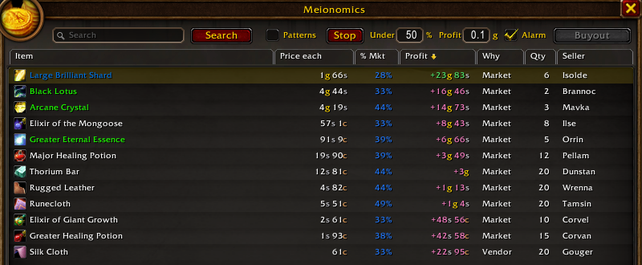

# Meionomics

The cheapest way to level your professions in WoW Forever, plus what to craft for profit,
what to sell and what to buy.

## The cheapest way to level your professions

Meionomics plans every skill-up from your own Auction House's prices: which recipe at each
step, what to buy, what to learn and what to sell back. With the same prices and the same
skill-up chances, it costs less gold than following the guides.


**Levelling professions for Legacy points?** Alchemy, Blacksmithing, Enchanting,
Engineering, Leatherworking and Tailoring each give a Legacy point at 150, 225 and 300:
18 points for your account. Meionomics gets you to each milestone for the least gold.

## Route to a skill

Type the skill you want and Meionomics gives the cheapest route there: which recipe for
each stretch of skill, how many crafts, what to learn and every material in one list.


Hover the summary for what the route costs and what selling the crafts brings back.


## Skill-up

Every recipe that still gives points, known or learnable, cheapest per point first, with
a verdict (Do it, If levelling, Costly), the chance of a skill-up and where to learn it.


## Queue

Click recipes or a whole route to queue them. The queue works out what to take from bags,
bank, mail and alts and what to buy, and crafts intermediates (bolts, bars) first.
**Craft next** crafts the next step.


## Auction House

A Meionomics tab at the Auction House. Uses TradeSkillMaster's prices when installed, else
scans the AH itself.

**Shopping** buys what the queue needs, cheapest first, and skips listings priced too
high.


**Sniper** watches new listings and sounds an alarm for deals below market or vendor
price.



**Sell** prices your bag items to sell within a day and posts them one click at a time.


Also: Browse (deals below market or vendor price), Patterns worth learning and BiS
upgrades.

## Flips

Crafting chains that turn gold into more gold, using every character's recipes: profit,
margin, gold per hour and how many a day the AH can take.


## Also

- **Profit**: every recipe with a verdict (Do it, Slow seller, Costly...), profit after
  the AH cut and how many sell a day
- **Find**: every recipe of your professions, known or not, with where to get the pattern
  and how many sales pay it back
- **Tooltips**: best way to sell an item (AH, vendor, disenchant, craft), sales a day, how
  many you and your alts have; quest reward values
- **Worth window**: what every character's bags, bank, gear, mail and auctions are worth
- **Merchants**: buy the queue's materials, sell junk (never gear), one click each

Hover any row for details; hold Shift for the full breakdown.

## Coming soon

- Prices follow your own AH searches for cloth, herbs and ore, so craft and flip profits
  match what the AH shows
- Invest: where a daily pot of gold makes the most each day


## Settings

Esc > Options > AddOns > Meionomics. Key bindings: craft next, craft one, open the panel,
post the next Sell row.

## Slash commands

- `/meio`: every command
- `/meio craft`: the crafting panel
- `/meio find [name]`: every recipe, known or not
- `/meio flips [name]`: crafting chains that make money, all characters
- `/meio worth`: the Worth window
- `/meio snipe`: deal alarms and the AH tab's Sniper
- `/meio quote <item>`: sell or keep

## TSM fixes

Optional fixes to TSM for WoW Forever, applied by `mods.ps1` from the
[GitHub repository](https://github.com/MeioNeiz/Meionomics#install).

| Patch | Fixes |
|---|---|
| 10-tsm-chat-tab-dropdown | Settings > General crashed when the saved chat tab was blank |
| 11-tsm-alt-realm-tooltip | Settings > Tooltip crashed on alt realm lines |
| 13-tsm-always-compare | TSM item tooltips compare with your equipped gear without holding Shift |
| 15-apphelper-without-tsm | TSM's AppHelper loads without TSM, so Meionomics can read the desktop app's prices on its own |
| 16-tsm-auction-selected-hook | Clicking a result in TSM's auction window opens Meionomics' price history |
| 17-tsm-recipe-row-tooltip | Hovering a recipe in TSM's profession window shows the crafted item's tooltip |

## Install

Use your addon manager (CurseForge, Wago), or unzip a
[GitHub release](https://github.com/MeioNeiz/Meionomics/releases/latest) into
`World of Warcraft\_forever_\Interface\AddOns` and restart WoW fully. Optional:
[TradeSkillMaster](https://tradeskillmaster.com) and its desktop app for market prices,
[Syndicator](https://www.curseforge.com/wow/addons/syndicator) for counts on alts,
[Questie](https://www.curseforge.com/wow/addons/questie) for pattern sources.

**With the TSM fixes:** install PowerShell 7 (`winget install Microsoft.PowerShell`),
download this repository (green **Code** button, **Download ZIP**), extract it and run in
that folder:

```
pwsh -ExecutionPolicy Bypass -File mods.ps1
```

It copies Meionomics into your AddOns folder and applies the fixes, keeping a backup of
each TSM file it changes in `backups\`. Another WoW folder: add
`-AddOns "D:\Games\World of Warcraft\_forever_\Interface\AddOns"`. A TSM update undoes the
fixes: run it again. `mods.ps1 status` checks without changing anything; a **BROKEN** patch
means TSM changed that code (look for a newer version here). `mods.ps1 revert <patch-name>`
undoes one.

## Feedback

Bugs and ideas: [GitHub issues](https://github.com/MeioNeiz/Meionomics/issues)

## More Meio addons

[Meio Trainer Compare](https://www.curseforge.com/wow/addons/trainercompare) | [Meio Next Stop](https://www.curseforge.com/wow/addons/leavebutton) | [Meio Auto Rank](https://www.curseforge.com/wow/addons/meio-autorank) | [Meio Meter Hover](https://www.curseforge.com/wow/addons/meterhover) | [Meio Map](https://addons.wago.io/addons/meiomap) | [Meio Alts](https://addons.wago.io/addons/meioalts) | [Meio DPS](https://addons.wago.io/addons/meiodps) | [Meio Plates](https://addons.wago.io/addons/meioplates) | [Meio Hub](https://addons.wago.io/addons/meiohub) | [Meio Pets](https://addons.wago.io/addons/meiopets) | [Meio Stats](https://addons.wago.io/addons/meiostats) | [Meio Bags](https://addons.wago.io/addons/meiobags) | [Meio Fixes](https://addons.wago.io/addons/meiofixes) | [Meio Flight Times](https://addons.wago.io/addons/meioflighttimes) | [Meio Tooltip Fold](https://addons.wago.io/addons/meiotooltipfold) | [Meio Auto Run Turn](https://addons.wago.io/addons/meioautorunturn) | [Meio Mail](https://addons.wago.io/addons/meiomail) | [Meio QoL](https://addons.wago.io/addons/meioqol) | [Meio TSM Browse](https://addons.wago.io/addons/tsmbrowse) | [Meio Shards](https://addons.wago.io/addons/meioshards) | [Meio Spike Check](https://addons.wago.io/addons/meiospikecheck) | [Meio BiS Extras](https://addons.wago.io/addons/meiobisextras) | [Meio Buff Thanks](https://addons.wago.io/addons/meiobuffthanks) | [Meio Flare Fixes](https://addons.wago.io/addons/meioflarefixes) | [Meio Flare Questie](https://addons.wago.io/addons/meioflarequestie)

## Licence

[MIT](LICENSE)
