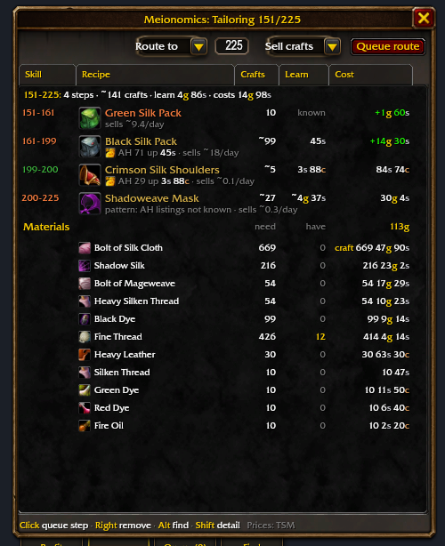
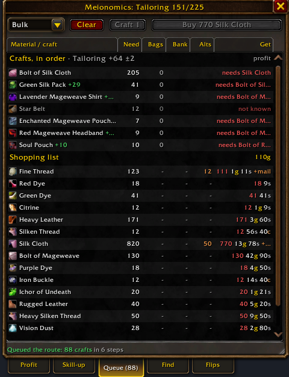
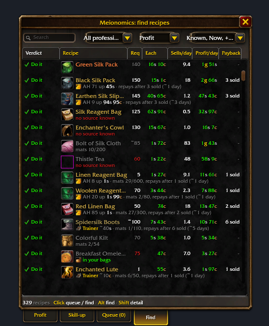

# Meionomics

What to craft for profit or skill-ups, what to sell and what to buy, for WoW Forever.

| Skill-up | Route to a target |
|---|---|
|  |  |
| **Queue and shopping list** | **Find any recipe** |
|  |  |

## What it does

A panel beside your profession window, and a Meionomics tab at the Auction House. Uses
TradeSkillMaster's prices when installed, else scans the AH itself.

- **Profit**: every recipe with a verdict (Do it, Slow seller, Costly...), profit after
  the AH cut and how many sell a day
- **Skill-up**: cheapest per point first, or **Route to** a skill you type in
- **Queue**: click recipes to queue them; it works out what to take from bags, bank, mail
  and alts, what to buy, and crafts intermediates (bolts, bars) first. **Craft next**
  crafts the next step
- **Find**: every recipe of your professions, known or not, with where to get the pattern
  and how many sales pay it back
- **Flips**: chains that turn gold into more gold, using every character's recipes
- **Auction House**: Browse (deals below market or vendor price), Patterns worth learning,
  Sell (your bag items at a price that sells within a day), Shopping (what the queue
  needs), BiS upgrades, and a Sniper with deal alarms
- **Tooltips**: best way to sell an item (AH, vendor, disenchant, craft), sales a day, how
  many you and your alts have; quest reward values
- **Worth window**: what every character's bags, bank, gear, mail and auctions are worth
- **Merchants**: buy the queue's materials, sell junk (never gear), one click each

Hover any row for details; hold Shift for the full breakdown.

## Settings

Esc > Options > AddOns > Meionomics. Key bindings: craft next, craft one, open the panel,
post the next Sell row.

## Slash commands

- `/meio`: every command
- `/meio craft`: the crafting panel (`/meio craft next`, `/meio craft clear`...)
- `/meio find [name]`: every recipe, known or not
- `/meio flips [name]`: crafting chains that make money, all characters
- `/meio whatif [profession] [skill]`: the panel at another skill
- `/meio worth`: the Worth window
- `/meio history <item>`: an item's price history
- `/meio snipe`: deal alarms and the AH tab's Sniper
- `/meio quote <item>`, `/meio sells <item>`, `/meio posts`: sell or keep, how fast it
  sells, how your posts sold
- `/meio autoscan on|off`, `/meio autoprice on|off`: AH scan on opening, Sell tab prices
- `/meio source`, `/meio sell`, `/meio mat`: where prices come from, TSM price strings
- `/meio legacy`: the Working Overtime talent's effect on skill-ups
- `/meio tooltips on|off`, `/meio fields`, `/meio ahdetail on|off`: what tooltips show
- `/meio reset`: windows back where they start

## TSM fixes

Optional fixes to TSM for WoW Forever, applied by `mods.ps1` from the
[GitHub repository](https://github.com/MeioNeiz/Meionomics#install).

| Patch | Fixes |
|---|---|
| 10-tsm-chat-tab-dropdown | Settings > General crashed when the saved chat tab was blank |
| 11-tsm-alt-realm-tooltip | Settings > Tooltip crashed on alt realm lines |
| 13-tsm-always-compare | TSM item tooltips compare with your equipped gear without holding Shift |
| 15-apphelper-without-tsm | TSM's AppHelper loads without TSM, so Meionomics can read the desktop app's prices on its own |
| 16-tsm-auction-selected-hook | Clicking a result in TSM's auction window opens Meionomics' price history |
| 17-tsm-recipe-row-tooltip | Hovering a recipe in TSM's profession window shows the crafted item's tooltip |

## Install

Use your addon manager (CurseForge, Wago), or unzip a
[GitHub release](https://github.com/MeioNeiz/Meionomics/releases/latest) into
`World of Warcraft\_forever_\Interface\AddOns` and restart WoW fully. Optional:
[TradeSkillMaster](https://tradeskillmaster.com) and its desktop app for market prices,
[Syndicator](https://www.curseforge.com/wow/addons/syndicator) for counts on alts,
[Questie](https://www.curseforge.com/wow/addons/questie) for pattern sources.

**With the TSM fixes:** install PowerShell 7 (`winget install Microsoft.PowerShell`),
download this repository (green **Code** button, **Download ZIP**), extract it and run in
that folder:

```
pwsh -ExecutionPolicy Bypass -File mods.ps1
```

It copies Meionomics into your AddOns folder and applies the fixes, keeping a backup of
each TSM file it changes in `backups\`. Another WoW folder: add
`-AddOns "D:\Games\World of Warcraft\_forever_\Interface\AddOns"`. A TSM update undoes the
fixes: run it again. `mods.ps1 status` checks without changing anything; a **BROKEN** patch
means TSM changed that code (look for a newer version here). `mods.ps1 revert <patch-name>`
undoes one.

## Feedback

Bugs and ideas: [GitHub issues](https://github.com/MeioNeiz/Meionomics/issues)

## More Meio addons

[Meio TrainerCompare](https://www.curseforge.com/wow/addons/trainercompare) | [Meio Next Stop](https://www.curseforge.com/wow/addons/leavebutton) | [Meio AutoRank](https://www.curseforge.com/wow/addons/meio-autorank) | [Meio MeterHover](https://www.curseforge.com/wow/addons/meterhover) | [Meio Map](https://addons.wago.io/addons/meiomap) | [Meio Alts](https://addons.wago.io/addons/meioalts) | [Meio DPS](https://addons.wago.io/addons/meiodps) | [Meio Plates](https://addons.wago.io/addons/meioplates) | [Meio Hub](https://addons.wago.io/addons/meiohub) | [Meio Pets](https://addons.wago.io/addons/meiopets) | [Meio Stats](https://addons.wago.io/addons/meiostats) | [Meio Bags](https://addons.wago.io/addons/meiobags) | [Meio Fixes](https://addons.wago.io/addons/meiofixes) | [Meio Flight Times](https://addons.wago.io/addons/meioflighttimes)

## Licence

[MIT](LICENSE)
