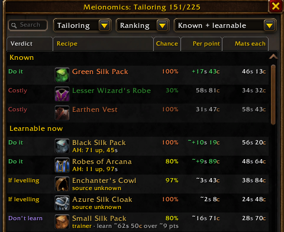

# Meionomics

A crafting and pricing addon for **WoW Forever**. It sits beside your profession window and
tells you what to craft: what makes money, what levels you most cheaply, and the cheapest
route to a target skill. It also builds a shopping list and crafts intermediates such as
bolts for you. Works for every crafting profession: Alchemy, Blacksmithing, Cooking,
Enchanting, Engineering, First Aid, Leatherworking, Mining (smelting) and Tailoring.

It uses TradeSkillMaster's prices when TSM is installed, and scans the Auction House itself
when it isn't.

| Skill-up | Route to a target |
|---|---|
|  |  |
| **Queue and shopping list** | **Find any recipe** |
|  |  |

## What it does

- **Profit**: every recipe you know, with a verdict (Do it, Slow seller, Costly...), profit
  after the 5% AH cut and how many sell per day.
- **Skill-up**: recipes that give skill points, cheapest per point first, including what it
  costs to learn them. Switch the dropdown to **Route to** for the cheapest sequence of crafts
  up to a skill you type in.
- **Queue**: click recipes to queue them (Shift-click adds 10). The queue works out what
  to take from your bags, bank, mailbox and alts, what to buy, and which intermediates
  (bolts, bars...) to craft first. **Craft next** crafts the next step in one batch.
- **Find**: every recipe of your professions, known or not, also those above your skill:
  where to get the pattern (AH, vendor, trainer, drop), profit each, how many sell a day,
  profit a day, and how many you need to sell before the pattern has paid for itself.
- **Item tooltips**: best way to sell an item (AH, vendor, disenchant, craft into something),
  minimum buyout against market value, sales per day, how many you and your alts have.
- **Auction House**: suggested posting prices on the Sell tab.
- **Price history**: click any result in TSM's Browse or Sniper tab and a panel opens beside
  TSM's window: whether the price is rising, steady or falling (3-day vs 60-day average from
  TSM), the region average and how many are listed now, the 60, 14 and 3-day averages and the
  current lowest buyout as bars, so there's a chart from the first click, and a 30-day daily
  chart of market value and lowest buyout. The daily chart builds from the AH scan Meionomics
  runs when you open the Auction House, one point a day, so it fills in over the days you
  play; items you click are tracked from then on. Needs patch 16.

Hover any row for the details; hold Shift for the full breakdown.

## Install

### 1. TradeSkillMaster (recommended)

Install [TradeSkillMaster](https://tradeskillmaster.com) the way you normally install addons.
For market prices, also run the TSM desktop application so it downloads auction data.

Meionomics also scans the Auction House itself when you open it (at most once every 15
minutes): that gives it prices without TSM and builds its price history. `/meio autoscan off`
turns this off.

### 2. Meionomics

**Simple way:** download `Meionomics-<version>.zip` from
[Releases](https://github.com/MeioNeiz/Meionomics/releases) and extract it into
`World of Warcraft\_forever_\Interface\AddOns`, so that you end up with
`AddOns\Meionomics\Meionomics.toc`. Restart WoW fully (a `/reload` doesn't find new addons).

**With the TSM fixes (recommended if you use TSM):** the installer below copies Meionomics
into your AddOns folder and applies small fixes to TSM for WoW Forever (see
[TSM fixes](#tsm-fixes)).

1. Install PowerShell 7 if you don't have it. In a terminal: `winget install Microsoft.PowerShell`
   (Windows PowerShell 5, the one built into Windows, won't run the installer).
2. Download this repository (green **Code** button, **Download ZIP**) and extract it anywhere.
3. Open a terminal in the extracted folder and run:

   ```
   pwsh -ExecutionPolicy Bypass -File mods.ps1
   ```

   If WoW isn't in `C:\Program Files (x86)\World of Warcraft`, add the path to your AddOns
   folder: `-AddOns "D:\Games\World of Warcraft\_forever_\Interface\AddOns"`.
4. Restart WoW fully.

`-ExecutionPolicy Bypass` is needed because Windows blocks scripts downloaded from the
internet. Read `mods.ps1` first if you'd like to check what it does: it only copies the
addon and edits the TSM files the patches name, and keeps a backup of each file it changes
in `backups\`.

**After a TSM update** run the installer again: the update undoes the fixes. To check
without changing anything: `pwsh -ExecutionPolicy Bypass -File mods.ps1 status`. If it
reports a patch as **BROKEN**, TSM changed that code; look for a newer version of this
repository. To undo one fix: `pwsh -ExecutionPolicy Bypass -File mods.ps1 revert <patch-name>`.

## Use

- Open a profession: the panel docks beside it. `/meio craft` opens it on its own.
- `/meio find` opens the Find view.
- `/meio history <item>` opens the price history anywhere; `/meio history off` turns the
  panel off.
- `/meio options` chooses what item tooltips show; `/meio` lists the other commands.

Click a row to queue it, right-click to remove one, Ctrl-click to type a count, Alt-click
to search the AH for it (or get its Wowhead link).

Optional addons it uses when installed:
[Syndicator](https://www.curseforge.com/wow/addons/syndicator) (counts on your alts) and
[Questie](https://www.curseforge.com/wow/addons/questie) (which vendors sell a pattern and
which mobs drop it; without it some patterns show "source unknown").

## TSM fixes

| Patch | Fixes |
|---|---|
| 10-tsm-chat-tab-dropdown | Settings > General crashed when the saved chat tab was blank |
| 11-tsm-alt-realm-tooltip | Settings > Tooltip crashed on alt realm lines |
| 12-tsm-enchanting-scan | TSM's Enchanting crafting window stayed empty and its Craft button crashed: TSM looks for retail enchanting scrolls that WoW Forever doesn't have |
| 13-tsm-always-compare | TSM item tooltips compare with your equipped gear without holding Shift |
| 15-apphelper-without-tsm | TSM's AppHelper loads without TSM, so Meionomics can read the desktop app's prices on its own |
| 16-tsm-auction-selected-hook | Lets Meionomics know which result you clicked in TSM's auction window (for the price history panel) |

A patch for an addon you don't have is skipped.

## Licence

[MIT](LICENSE)
